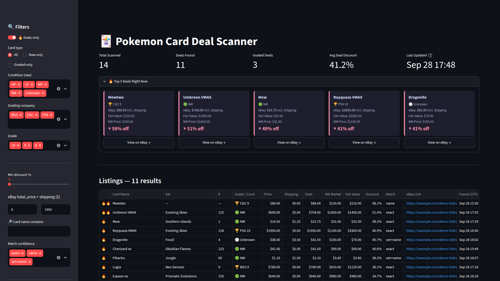

# eBay Pokémon Card Deal Scanner

Finds underpriced Pokémon cards on eBay. The scanner reads new Buy It Now listings
through eBay's official **Browse API**, matches each listing title to a specific
printing in the [pokemontcg.io](https://pokemontcg.io) card catalog, prices it with
TCGPlayer market data, adjusts for the card's condition or professional grade, and
flags listings whose **total cost (price + shipping)** is well below fair value.
Results go to SQLite and CSV, a Streamlit dashboard, and (optionally) Discord.


<sub>Dashboard rendered from a small demo database. The listings and prices are made up and the links point to example.com.</sub>

**Why:** good cards priced well under market sell fast, and checking every listing
by hand against price guides doesn't scale. Automating the scan means solving a few
problems: matching free-text listing titles to one card out of ~20,000 printings,
estimating fair value when condition and grade vary, and keeping the pipeline
honest about what the data can and can't tell you.

## How it works

```text
eBay Browse API ─► listings.py ─► matcher.py ───► prices.py ───► deals.py ─► deals.db / CSV / Discord
(active BIN        (map fields,    (title → card,   (NM price from   (fair value,       │
 listings)          drop lots)      grade/condition)  pokemontcg.io)  discount)          ▼
                                                                                    dashboard.py
```

1. **Search**: `listings.py` calls eBay's `item_summary/search` with the search
   terms from `config.json`. By default it searches single cards only (category
   183454, *CCG Individual Cards*), Buy It Now listings, shipping to your
   marketplace's country, newest first. Lots, sealed product, accessories and
   multi-variation listings are dropped. Foreign-language, proxy and code-card
   listings are skipped, because they would be compared against the wrong price.
2. **Match** (`matcher.py`): each title is matched to the catalog in priority order:
   - **exact**: set name + card number (`4/102`, `#199`), accepted only when the
     title also names the card. A mistyped number can't turn a Blastoise into a
     Charizard.
   - **set+name**: card name + set, first printing in that set
   - **name**: card name only. The price is the median across that card's printings.
3. **Grade / condition**: eBay's structured data comes first. In trading-card
   categories, condition ID **2750 = graded** and **4000 = ungraded**. With
   `fetch_listing_condition` on, `getItem` also supplies the grader, grade and
   card condition (e.g. *Lightly Played (Excellent)*). Anything missing is read
   from the title (`PSA 10`, `BGS 9.5`, `NM`, `LP`, ...).
4. **Price** (`prices.py`): TCGPlayer market price of the matched printing from
   pokemontcg.io (no API key needed), cached for 15 minutes.
5. **Score** (`deals.py`), then save, print, and optionally alert.

### How deals are scored

```text
fair value = NM market price × multiplier
cost       = item price + shipping        (shipping only when it is a fixed amount)
discount % = (fair value − cost) / fair value × 100
deal       = discount % ≥ discount_threshold   (default 30)
```

The multiplier comes from `config.json`: `grade_multipliers` for graded cards
(`"PSA 10": 3.0` means a PSA 10 is worth 3× the raw NM price) and
`condition_multipliers` for raw cards (`"LP": 0.70`).

*Example:* NM price $100, card is Lightly Played → fair value $100 × 0.70 = $70.
Listed at $45 + $5 shipping → cost $50 → discount (70 − 50) / 70 = 28.6%. That is
**not** a deal at the default 30% threshold. On item price alone it would have
scored 35.7%, which is why shipping is included.

## Setup

Requires **Python 3.11+** (tested with 3.11 and 3.13).

```bash
git clone https://github.com/nathangin/ebay-scanner.git
cd ebay-scanner
python -m venv .venv
source .venv/bin/activate          # Windows: .venv\Scripts\activate
pip install -r requirements.txt
cp .env.example .env               # then fill in your keys (see below)
```

Run every script from the project folder. Output files and caches are written there.

### eBay API setup

1. Create a free account in the [eBay Developers Program](https://developer.ebay.com).
2. On the [Application Keys](https://developer.ebay.com/my/keys) page, create a
   **Production** keyset. You need its **App ID (Client ID)** and **Cert ID (Client Secret)**.
3. Before your first production call, eBay requires you to either subscribe to
   *Marketplace Account Deletion* notifications or opt out if you qualify. See
   [eBay's guide](https://developer.ebay.com/develop/guides/sell/marketplace-user-account-deletion)
   (the setting is under *Notifications* next to your App ID).
4. Put the keys in `.env`. It is gitignored, so it never gets committed:

```dotenv
EBAY_CLIENT_ID=YourName-YourApp-PRD-0123456789-abcdef01
EBAY_CLIENT_SECRET=PRD-0123456789ab-cdef-0123-4567-89ab
```

| Variable | Required | Default | Purpose |
|---|---|---|---|
| `EBAY_CLIENT_ID` | yes | – | App ID of your eBay keyset |
| `EBAY_CLIENT_SECRET` | yes | – | Cert ID of the same keyset |
| `EBAY_MARKETPLACE_ID` | no | `EBAY_US` | eBay site to search; also sets the ship-to country filter |
| `EBAY_ENV` | no | `production` | `sandbox` to use a Sandbox keyset (the sandbox has very little test data) |
| `PRICECHARTING_TOKEN` | for `pc_cost.py` | – | PriceCharting API token, see [PriceCharting](#pricecharting) |
| `DISCORD_WEBHOOK_URL` | no | – | Deal alerts, see [Discord alerts](#discord-alerts-optional) |

The scanner uses an OAuth **application token** (client credentials grant,
scope `https://api.ebay.com/oauth/api_scope`). The token lives for about two hours.
It is cached in memory and renewed shortly before it expires, because eBay limits
how many tokens an app can mint per day. Every script that calls eBay checks for
credentials at startup and points back to this section if they are missing.

### First run

```bash
python build_card_list.py    # one-time, ~2 minutes: downloads ~20k cards to card_catalog.json
python main.py               # start scanning (Ctrl+C to stop)
streamlit run dashboard.py   # in a second terminal: browse the results
```

## Scripts

| Script | What it does | Writes |
|---|---|---|
| `build_card_list.py` | Downloads the full pokemontcg.io catalog (id, name, number, set) | `card_catalog.json` |
| `main.py` | Continuous deal scanner for raw and graded cards | `deals.db`, `deals.csv`, `deals_only.csv` |
| `dashboard.py` | Streamlit UI over `deals.db` | – |
| `scan_favorites.py` | One-shot scan of the groups in `favorites.json` | console report |
| `scan_set.py` | One-shot scan of every card in a set (Southern Islands; edit the list at the top) | console report |
| `scan_chinese_boxes.py` | Chinese booster boxes vs hand-maintained PriceCharting prices | console report |
| `cost_to_collect.py` | Cost to collect every card of each Pokémon (ungraded) | `cost_to_collect.csv`, `price_cache.json` |
| `pc_cost.py` | The same for your favorites, using PriceCharting's API | `pricecharting_cache.json` |

**`main.py`** cycles through `search_terms`, one search every
`poll_interval_seconds`. New listings are saved to `deals.db` and `deals.csv`.
Deals also go to `deals_only.csv`, the console, and Discord if configured. Example
console line (illustrative):

```text
[DEAL 🔥] Mew | Southern Islands #1 | NM | eBay: $15.75 (incl. $1.25 shipping) | Fair Value: $31.00 | NM: $31.00 | 49% off
  https://www.ebay.com/itm/123456789012
```

**`scan_favorites.py`** reads `favorites.json` and prints a table per group, sorted
by discount, followed by the deal links. Shipping is included where known; an `*`
marks listings whose shipping is calculated at checkout.

```bash
python scan_favorites.py
python scan_set.py
python scan_chinese_boxes.py
```

**`cost_to_collect.py`** groups every Pokémon card by species ("Dark Vileplume",
"Erika's Vileplume ex" and "Vileplume VMAX" all count as *Vileplume*). For each
card it takes the cheapest ungraded price and sums them. The first run downloads
all prices (a few minutes); later runs use `price_cache.json`.

```bash
python cost_to_collect.py                # cheapest / most expensive species tables + CSV
python cost_to_collect.py vileplume      # card-by-card detail for one Pokémon
python cost_to_collect.py --refresh      # re-download prices
python cost_to_collect.py --fill-missing # eBay asking prices for cards with no price data
```

`--fill-missing` fills in cards that have no TCGPlayer or CardMarket price. It uses
the **median of the cheapest current Buy It Now asking prices** for the ungraded
card, not sold prices (see [Limitations](#limitations)). These values are marked
with `*` and labelled "eBay asking" in the output. They are cached in
`asking_price_cache.json` with a note saying they are asking prices, and counted
in the CSV's `asking_priced` column. Each missing card costs one API call.

**`pc_cost.py`** prints, for each Pokémon in the `tcg_cards` groups of
`favorites.json`, the PriceCharting ungraded total plus a per-card table with
ungraded and PSA 10 prices. See [PriceCharting](#pricecharting).

## Dashboard

```bash
streamlit run dashboard.py
```

- Summary metrics, plus cards for the top 5 current deals with *View on eBay* buttons
- Filters: deals only, raw/graded, condition, grading company, grade, minimum
  discount, total price range, card name, match confidence
- Sortable table with item price, shipping, total, NM market price, fair value,
  discount and a link to each listing
- CSV download of the filtered rows or the deals only

It reads `deals.db` from the current folder and caches it for 30 seconds. Click
*Refresh* to reload immediately.

## Configuration

`config.json` (your values are merged over the built-in defaults):

| Key | Default | Meaning |
|---|---|---|
| `discount_threshold` | `30` | Minimum % below fair value to count as a deal |
| `search_terms` | 8 queries | eBay searches `main.py` cycles through |
| `condition_multipliers` | NM 1.0, LP 0.70, MP 0.45, HP 0.25, DMG 0.10, Unknown 0.70 | Raw-card multiplier on the NM price |
| `grade_multipliers` | PSA 10 3.0, PSA 9 1.5, BGS 9.5 4.0, ... | Graded-card multiplier. Keys are `"COMPANY GRADE"`; a company-only key (`"CGC"`) works as a fallback; unknown grades use 1.0 |
| `poll_interval_seconds` | `300` | Pause between searches |
| `max_listings_per_query` | `25` | Listings kept per search |
| `fetch_listing_condition` | `false` | Call `getItem` for grader / grade / card condition. Costs one extra API call per new, matched, priced listing |
| `ebay_category_ids` | `["183454"]` | eBay categories to search (*CCG Individual Cards*). `[]` searches all categories |
| `discord_webhook_url` | `""` | Discord webhook. Prefer the `DISCORD_WEBHOOK_URL` env var, which wins if both are set |

`favorites.json` holds groups of three types:

```json
[
  {"name": "Southern Islands", "type": "tcg_cards", "deal_threshold": 25,
   "title_must_contain": "southern islands",
   "cards": [{"card_id": "si1-1", "name": "Mew", "search": "Southern Islands Mew pokemon card"}]},

  {"name": "Yuka Morii", "type": "artist_search", "deal_threshold": 25,
   "search_terms": ["yuka morii pokemon card holo"]},

  {"name": "Sealed", "type": "sealed_boxes", "deal_threshold": 15,
   "items": [{"name": "Gem Pack", "pc_price": 68.70, "search": "Pokemon Chinese Gem Pack booster box sealed"}]}
]
```

`tcg_cards` compares against the NM price of a pokemontcg.io `card_id`.
`artist_search` matches whatever the searches find against the catalog.
`sealed_boxes` uses a reference price you maintain by hand. Any group can set
`"category_ids"`. Card groups default to 183454; sealed groups search all
categories.

**API budget:** eBay's default Browse API limit is 5,000 calls per day. The default
config makes one search every 5 minutes (~290 calls/day). `fetch_listing_condition`
adds one `getItem` call per new priced listing. `--fill-missing` adds one call per
unpriced card.

## Discord alerts (optional)

1. In Discord, create a webhook for the channel you want alerts in (channel
   settings → *Integrations* → *Webhooks*) and copy its URL.
2. Add it to `.env` (keeps it out of git) or to `discord_webhook_url` in `config.json`:

```dotenv
DISCORD_WEBHOOK_URL=https://discord.com/api/webhooks/...
```

`main.py` then posts one embed per new deal: card, discount, eBay total, fair value,
NM price, set, grade/condition, match confidence and the listing photo. It uses
plain `requests`; @mentions are disabled so a listing title can't ping anyone. A
failed alert is logged and never stops the scanner. Alerts are off when no URL is set.

## PriceCharting

`pc_cost.py` uses [PriceCharting's official API](https://www.pricecharting.com/api-documentation),
which requires a **paid PriceCharting subscription**. Copy the API token from your
subscription page (*API/Download*) into `.env`:

```dotenv
PRICECHARTING_TOKEN=your-40-character-token
```

Without a token the script exits with a message pointing here. For each Pokémon it
calls `/api/products?q=<name>` (the API returns the first 20 matches). It keeps
Pokémon card products whose name contains the Pokémon, then reads each card's prices
from `/api/product?id=<id>`. PriceCharting allows one call per second, so the script
throttles itself and caches product prices for 24 hours in
`pricecharting_cache.json`. Prices arrive in pennies. For trading cards the API
docs define the fields as:

| Field | Card meaning | Field | Card meaning |
|---|---|---|---|
| `loose-price` | Ungraded | `box-only-price` | Grade 9.5 |
| `cib-price` | Grade 7 / 7.5 | `manual-only-price` | PSA 10 |
| `new-price` | Grade 8 / 8.5 | `bgs-10-price` | BGS 10 |
| `graded-price` | Grade 9 | `condition-17-price` / `-18-price` | CGC 10 / SGC 10 |

The cost-to-collect total uses the ungraded `loose-price`.

## Limitations

- **No sold prices.** The Browse API only returns *active* listings. Sold history
  needs eBay's [Marketplace Insights API](https://developer.ebay.com/api-docs/buy/marketplace-insights/static/overview.html),
  a Limited Release API open only to developers eBay approves. That is why
  `--fill-missing` uses asking prices, which can differ a lot from actual sale prices.
- **English reference prices.** pokemontcg.io's TCGPlayer prices are for English
  cards, so `main.py` skips Japanese and other-language listings. When TCGPlayer
  has no price, the CardMarket fallback is in EUR and is used as-is. Deal math
  assumes USD listings (`EBAY_US`).
- **pokemontcg.io is deprecated.** Its maintainers have closed new API key
  sign-ups and point users to [Scrydex](https://scrydex.com); existing keys work
  through March 1, 2027. The scanner uses the keyless tier, so the card catalog
  and reference prices depend on that service staying online. Scrydex is the
  replacement for `prices.py` and `build_card_list.py` if it goes away.
- **Matching is heuristic.** Name-only matches use the median across printings.
  1st Edition vs Unlimited and holo vs reverse holo are not read from titles; the
  unlimited / regular price is used, which keeps fair value conservative.
- **Condition data.** Grader, grade and card condition come from `getItem`
  condition descriptors. eBay launched these for trading cards in 2023, initially
  on the UK marketplace, so they may be missing elsewhere; the title is parsed then.
- **Shipping.** Only fixed shipping is included in the total. Calculated shipping
  depends on the buyer's address, so it is treated as unknown, excluded, and flagged
  in the output. Taxes and import charges are not included.
- **Rate limits.** Browse API: 5,000 calls/day by default. OAuth tokens: 1,000
  mints/day (the client reuses its token). PriceCharting: 1 call/second.
  pokemontcg.io is a free public API and can be slow; prices are cached.
- **eBay's Buy API terms.** eBay describes production use of its Buy APIs as
  restricted and licensed separately. If searches return HTTP 403, check eBay's
  [Buy APIs requirements](https://developer.ebay.com/api-docs/buy/static/buy-requirements.html).
- **`pc_cost.py` coverage** is limited to the first 20 PriceCharting search results
  per Pokémon.

## Project structure

```text
ebay-scanner/
├── main.py                 # continuous scanner: search → match → price → score → store/alert
├── ebay_api.py             # eBay Browse API client (OAuth token cache, retries, search, getItem)
├── listings.py             # listing search/mapping, bundle filter, asking-price fallback
├── matcher.py              # title → catalog card matching, grade/condition detection
├── prices.py               # NM market prices from pokemontcg.io (TCGPlayer / CardMarket)
├── deals.py                # fair value, discount and deal flag
├── dashboard.py            # Streamlit dashboard
├── scan_favorites.py       # one-shot scan of favorites.json
├── scan_set.py             # one-shot scan of a set
├── scan_chinese_boxes.py   # one-shot scan of Chinese booster boxes
├── cost_to_collect.py      # cost to collect every card of each Pokémon
├── pc_cost.py              # PriceCharting cost to collect (official API)
├── build_card_list.py      # downloads card_catalog.json
├── config.json             # scanner settings
├── favorites.json          # cards / searches for scan_favorites.py and pc_cost.py
├── .env.example            # template for credentials (copy to .env)
├── requirements.txt        # runtime dependencies
├── requirements-dev.txt    # + pytest
├── docs/dashboard.png      # screenshot (demo data)
└── tests/                  # offline pytest suite
```

## Running the tests

```bash
pip install -r requirements-dev.txt
python -m pytest
```

GitHub Actions runs the same suite on Python 3.11 and 3.13 for every push and
pull request (`.github/workflows/tests.yml`).

The suite runs offline. Every HTTP call (eBay OAuth, search and getItem,
pokemontcg.io, PriceCharting, Discord) is mocked. It covers token caching and
refresh, retries and backoff, request building and response mapping, sort
mapping, the bundle filter, total-price deal math and multipliers, title
matching on a small fixture catalog, grade/condition detection, price parsing,
the asking-price fallback, PriceCharting parsing and throttling, the Discord
payload, database/CSV migration, and a Streamlit `AppTest` smoke test of the
dashboard.

---

Data from the eBay Browse API, [pokemontcg.io](https://pokemontcg.io) and
[PriceCharting](https://www.pricecharting.com). This project is not affiliated with
eBay, TCGPlayer, PriceCharting or The Pokémon Company.
